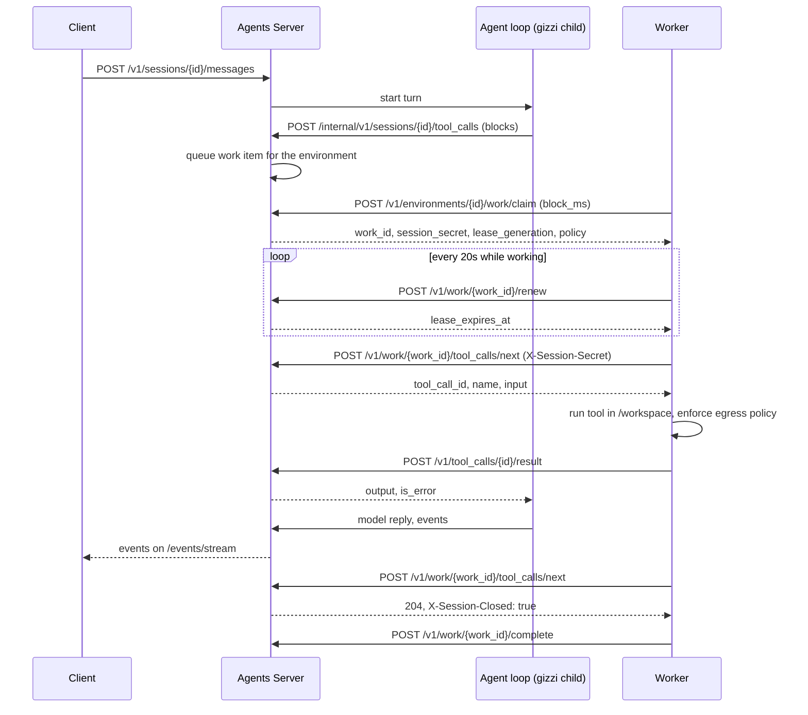

# Self-hosted worker protocol

How a sandbox worker talks to the Agents Server. The routes are in
`cmd/allternit-api/openapi/selfhost-v1.yaml`.

The worker only makes outbound HTTPS calls. The server never connects to a worker.

## What the worker does

The agent loop runs on the server. Model calls and MCP calls happen there.
They never reach the worker. When the loop needs a sandboxed tool, it queues a
tool call. A worker runs it and posts the result.

The worker runs these tools with gizzi's own tool code. The `name` of a tool
call is the gizzi tool id: `bash`, `read`, `write`, `edit`, `multiedit`,
`apply_patch`, `notebook_edit`, `grep`, `glob`, `list`, `symbol_edit`,
`task_list`, `task_output`, `task_stop` (background tasks), and
`scratchpad_list`, `scratchpad_read`, `scratchpad_write`, `scratchpad_remove`.
The worker also accepts the short names `ls`, `notebook` and `symbol-edit`.
The working directory is `/workspace`. `bash` runs inside bubblewrap on Linux
(sandbox-exec on macOS; Linux also needs `socat` for `limited` networking). A Linux worker without bubblewrap refuses bash calls.

In the agent loop, `GIZZI_TOOL_HOST=remote` (with `GIZZI_TOOL_HOST_URL` and
`GIZZI_TOOL_HOST_TOKEN`) sends these tools to the queue. They never run in the
loop process, even when no worker is attached. `run_code` is refused there,
because it would run code on the server.

Inside the server, the loop (the gizzi child process) hands a call to the queue with
`POST /internal/v1/sessions/{id}/tool_calls`. That route is loopback only, uses an
internal token, and is not part of the public API. The server runs one gizzi
child (`ALLTERNIT_GIZZI_BIN`, else `gizzi-code` on PATH) on a loopback port,
restarts it with backoff when it exits, and reports it on `/health/ready`.

### Custom tools

An agent's custom tools (`type: custom`) use the same queue. When the model
calls one, the worker gets a tool call whose `name` is the custom tool's name
and whose `input` follows its `input_schema`. The gizzi CLI worker does not
know custom tools and answers them with `is_error: true`. A worker built on
the SDK runs them with its own handlers and posts the result like any other.
Run custom tools only on workers that have handlers for them.

## Work items

- A session has **at most one open work item**. The server queues it the
  first time a turn needs a sandbox tool. A turn that only calls the model
  queues nothing and needs no worker.
- While nobody holds the session's item, the session shows
  `waiting_for_worker` (reason `no_worker`). If no worker takes a call within
  `sessions.no_worker_timeout` (default 10 minutes), the call fails with a
  tool error the model sees, and the call is closed, so a worker that attaches
  later does not run it.
- The item ends when the session is **archived**, or when the session has had
  no turn running and no pending tool call for **`sessions.idle_timeout`**
  (default 1 hour). From then on `tool_calls/next` answers 204 with
  `X-Session-Closed: true`, and the worker completes the item. The next turn
  that needs a tool queues a new item. An interrupt does not end the item.
- A worker serves one session at a time. Run one worker per concurrent session.
- Only 204 with `X-Session-Closed: true` ends the item. A plain 204 is an
  empty wait: poll again, never complete.
- Send `X-Worker-Hostname` and `X-Worker-Version` on claim, heartbeat, renew,
  complete and release. They show in `GET /v1/environments/{id}/workers`.

## Modes

| Mode | Flag | Behavior |
|---|---|---|
| Always-on | (default) | Claims work in a loop. Runs each item. Never exits on its own. |
| Drain | `--drain` | Claims one item and serves its tool calls. Completes it if the session finishes; if the session goes quiet first (an empty `tool_calls/next` poll after at least one call), releases it so the next call can go to any worker. Then exits 0. Exits 0 with no work too, after one empty claim. |
| On-work | `--on-work ./spawn.sh` | For each item, runs the script once. The worker keeps the lease alive until the script exits, then completes the item (exit 0) or completes it as `failed` (any other exit). The script gets the environment below and usually starts a per-session sandbox that runs `gizzi worker attach`. |

`--on-work` script environment:

| Variable | Value |
|---|---|
| `ALLTERNIT_SERVER_URL` | The server URL. |
| `ALLTERNIT_ENVIRONMENT_ID` | The environment. |
| `ALLTERNIT_WORK_ID`, `WORK_ID` | The work item. |
| `ALLTERNIT_SESSION_ID`, `SESSION_ID` | The session. |
| `ALLTERNIT_LEASE_GENERATION`, `LEASE_GENERATION` | The claim's lease generation. |
| `ALLTERNIT_WORK_SECRET` | The session secret. Pass it only to `gizzi worker attach`, never into the tool sandbox. `attach` removes it from its own environment before it runs a tool. |
| `ALLTERNIT_ENVIRONMENT_POLICY` | The claim's environment policy as JSON. |

The environment key is not passed to the script. `gizzi worker attach` reads
these variables, serves that one item's tool calls, and exits 0 when the
session finishes (3 if the lease moved to another worker). It does not renew,
complete or release; the parent worker does.

Other flags: `--block-ms`, `--reclaim-older-than-ms`, `--auto-stop`.

## Lease rules

- A claim gives a **60 second lease**.
- **Renew every 20 seconds** (`/renew`). Use `/heartbeat` between renewals if you want.
- Every claim raises the item's **`lease_generation`**. Every call about the item
  (`heartbeat`, `renew`, `complete`, `release`) carries the generation from the claim.
- If the generation is old, the server answers **409 `lease_stale`**. That means
  another worker owns the item. The worker must stop the work at once, discard
  its results, and not post a result.
- If a lease runs out, the item can be claimed again at once, and the server
  returns it to the queue within 5 seconds. This is how work from a dead
  worker comes back.
- `reclaim_older_than_ms` also lets a claim take a live lease that was last
  renewed at least that long ago (a stuck worker that still holds a lease).
  Use a value above the 20 second renew interval. 60000 or more adds nothing.
- On shutdown, call `/release`. The item goes back to ready now, with no wait.
- Finish with `/complete`. Completing twice with the current generation is safe.

## Tool calls: at least once

- The worker asks for the next call with `tool_calls/next` (long-poll, `block_ms`).
- A plain 204 means "nothing yet". A 204 with the header `X-Session-Closed: true`
  means the session is finished: the worker calls `/complete` for the item.
- A call that was handed out but has no result yet is handed out again after
  the lease changes hands. So a call can run more than once.
- Each call has a stable **`tool_call_id`**. The worker must run each id once
  and remember it. The server stores one result per id; a second post is ignored.
- Tool results are at most **100 KiB**. Larger output gets **413 `result_too_large`**.
  `gizzi worker` truncates to 100 KiB before posting and adds a note saying so.
- A result for an id that already has one is ignored and answered 200, with
  the stored status (`completed` or `errored`).
- Tools that change state outside the sandbox should be safe to repeat.

## The session secret

- The claim returns a `session_secret`. Send it as `X-Session-Secret` on the
  `tool_calls/next` and `tool_calls/{id}/result` routes.
- It works for **one session**. It does not work on any other session, and it
  cannot call `/v1/agents` or any admin route.
- It ends when the lease ends. A new claim gets a new secret.
- Do not write it to logs, the sandbox filesystem or tool output. Do not pass
  it into the sandbox. Only the worker process holds it.
- The environment key (`aek_...`) can claim work, and cannot read agents or other sessions.

## Egress policy the worker must enforce

The claim includes the environment policy. The worker enforces it on every
outbound connection from the sandbox, with a CONNECT proxy or the equivalent.

| Setting | Rule |
|---|---|
| `network: none` | Block all outbound traffic from the sandbox. |
| `network: limited` | Allow only hosts in `allowed_hosts`. Exact match. Refuse everything else with a clear error. |
| `network: full` | Allow any host. |
| `git.allowed_hostnames` | Git clone and push only to these hosts. |
| `git.allowed_push_refs` | Refuse a push to any ref that does not match. |

`gizzi worker` enforces `network` with the sandbox itself: `none` and
`limited` run bash in its own network namespace (bubblewrap `--unshare-net`;
on macOS a Seatbelt rule), and `limited` reaches only `allowed_hosts` through a
local CONNECT proxy that matches hosts exactly (an entry may carry a port).
`limited` with an empty list is the same as `none`. An unknown mode is
treated as `none`. The git rules come from a `git` wrapper first on the
sandbox `PATH` and a pre-push hook; it refuses other hosts, other refs,
`push --no-verify` and changes to `core.hooksPath`. A command that calls the
git binary by its full path skips the wrapper, so also protect the branches on
the git host.
| `mcp.allowed_hostnames` | Exact match, HTTPS only. A subdomain or `http://` host is refused. (MCP calls run on the server, but the list is part of the policy.) |

`gizzi worker` enforces `network` with the sandbox itself: `none` and
`limited` run bash in its own network namespace (bubblewrap `--unshare-net`;
on macOS a Seatbelt rule), and `limited` reaches only `allowed_hosts` through a
local CONNECT proxy that matches hosts exactly (an entry may carry a port).
`limited` with an empty list is the same as `none`. An unknown mode is
treated as `none`. The git rules come from a `git` wrapper first on the
sandbox `PATH` and a pre-push hook; it refuses other hosts, other refs,
`push --no-verify` and changes to `core.hooksPath`. A command that calls the
git binary by its full path skips the wrapper, so also protect the branches on
the git host.

The worker's own traffic to the server is not sandbox traffic. The sandbox
cannot reach the server API. Refusals use the code `host_not_allowed`. The
policy is the one from the claim. A change to the environment reaches a worker
on its next claim.

## Sequence

