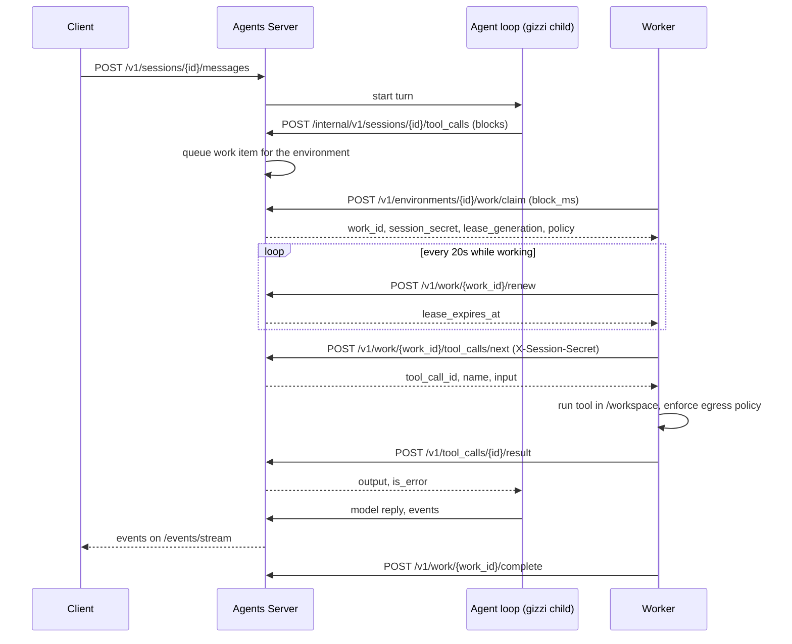

# Self-hosted worker protocol

How a sandbox worker talks to the Agents Server. The routes are in
`cmd/allternit-api/openapi/selfhost-v1.yaml`.

The worker only makes outbound HTTPS calls. The server never connects to a worker.

## What the worker does

The agent loop runs on the server. Model calls and MCP calls happen there.
They never reach the worker. When the loop needs a sandboxed tool, it queues a
tool call. A worker runs it and posts the result.

The worker runs these tools with gizzi's own tool code: `bash`, `read`, `write`,
`edit`, `multiedit`, `apply_patch`, `notebook`, `grep`, `glob`, `ls`,
`symbol-edit`, `background-task`, `scratchpad`. The working directory is
`/workspace`.

Inside the server, the loop (the gizzi child process) hands a call to the queue with
`POST /internal/v1/sessions/{id}/tool_calls`. That route is loopback only, uses an
internal token, and is not part of the public API.

## Modes

| Mode | Flag | Behavior |
|---|---|---|
| Always-on | (default) | Claims work in a loop. Runs each item. Never exits on its own. |
| Drain | `--drain` | Claims one item, runs it, completes it, and exits 0. Exits 0 with no work too, after one empty claim. |
| On-work | `--on-work ./spawn.sh` | For each item, runs the script once. The script gets `WORK_ID`, `SESSION_ID` and `LEASE_GENERATION` in its environment and starts a sandbox. The worker keeps the lease alive until the script exits. |

Other flags: `--block-ms`, `--reclaim-older-than-ms`, `--auto-stop`.

## Lease rules

- A claim gives a **60 second lease**.
- **Renew every 20 seconds** (`/renew`). Use `/heartbeat` between renewals if you want.
- Every claim raises the item's **`lease_generation`**. Every call about the item
  (`heartbeat`, `renew`, `complete`, `release`) carries the generation from the claim.
- If the generation is old, the server answers **409 `lease_stale`**. That means
  another worker owns the item. The worker must stop the work at once, discard
  its results, and not post a result.
- If a lease runs out, the item becomes ready again. Another worker may take it
  with `reclaim_older_than_ms`. This is how work from a dead worker comes back.
- On shutdown, call `/release`. The item goes back to ready now, with no wait.
- Finish with `/complete`. Completing twice with the current generation is safe.

## Tool calls: at least once

- The worker asks for the next call with `tool_calls/next` (long-poll, `block_ms`).
- A call that was handed out but has no result yet is handed out again after
  the lease changes hands. So a call can run more than once.
- Each call has a stable **`tool_call_id`**. The worker must run each id once
  and remember it. The server stores one result per id; a second post is ignored.
- Tool results are at most **100 KiB**. Larger output gets **413 `result_too_large`**.
  Truncate and post again.
- Tools that change state outside the sandbox should be safe to repeat.

## The session secret

- The claim returns a `session_secret`. Send it as `X-Session-Secret` on the
  `tool_calls/next` and `tool_calls/{id}/result` routes.
- It works for **one session**. It does not work on any other session, and it
  cannot call `/v1/agents` or any admin route.
- It ends when the lease ends. A new claim gets a new secret.
- Do not write it to logs, the sandbox filesystem or tool output. Do not pass
  it into the sandbox. Only the worker process holds it.
- The environment key (`aek_...`) can claim work, and cannot read agents or other sessions.

## Egress policy the worker must enforce

The claim includes the environment policy. The worker enforces it on every
outbound connection from the sandbox, with a CONNECT proxy or the equivalent.

| Setting | Rule |
|---|---|
| `network: none` | Block all outbound traffic from the sandbox. |
| `network: limited` | Allow only hosts in `allowed_hosts`. Exact match. Refuse everything else with a clear error. |
| `network: full` | Allow any host. |
| `git.allowed_hostnames` | Git clone and push only to these hosts. |
| `git.allowed_push_refs` | Refuse a push to any ref that does not match. |
| `mcp.allowed_hostnames` | Exact match, HTTPS only. A subdomain or `http://` host is refused. (MCP calls run on the server, but the list is part of the policy.) |

The worker's own traffic to the server is not sandbox traffic. The sandbox
cannot reach the server API. Refusals use the code `host_not_allowed`. The
policy is the one from the claim. A change to the environment reaches a worker
on its next claim.

## Sequence

