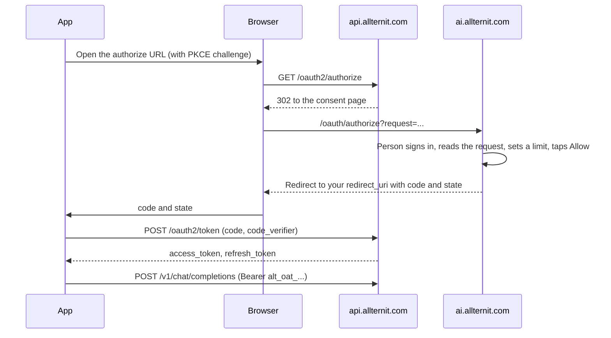

**Status: BUILDING.** The code is in review and not yet in production. See [status labels](/architecture#status-labels).

Sign in with Allternit makes Allternit an OAuth 2.0 authorization server. A person approves your app once. Your app then gets a token that calls Allternit models and bills the person's own Allternit credits, under a monthly limit the person chooses.

This page is for developers who build an app that signs people in. It is not the runtime's own gizzi sign-in; that is the [OAuth API](/api/oauth). People who link an app read [Apps with access to your account](/guides/apps-with-access).

## Who pays

| You send | Who pays |
|---|---|
| A project key (`alt_live_` or `alt_test_`) | Your project. This is unchanged. |
| An app token (`alt_oat_`) | The person who approved your app, from their credits, under the monthly limit they set. |

Your app never holds the person's password or their Allternit session. It holds a token that can only do what the scopes allow, and the person can revoke it at any time.

App-driven spend never triggers auto top-up. When the person's credits run out, calls fail with `402 user_credits_exhausted`.

## Register an app

1. Open **platform.allternit.com → OAuth apps** and pick a project.
2. Create the app: name, logo URL, homepage URL, privacy policy URL, and the client type.
3. Add the redirect URIs your app will use (see [Redirect rules](#redirect-rules)).
4. Copy the client id (`oapp_…`). For a confidential app the console shows the client secret (`alt_ocs_…`) once. Only its hash is stored. **Rotate secret** issues a new one and shows it once.
5. Add test users (up to 100 email addresses).
6. When you are ready for anyone to sign in, choose **Submit for review**. You can withdraw a submission.

The console calls these routes with your signed-in session. The project owner can use them directly.

| Method | Path | Purpose |
|---|---|---|
| `GET`, `POST` | `/api/v1/platform/projects/:id/oauth-apps` | List apps, create an app |
| `GET`, `PATCH`, `DELETE` | `/api/v1/platform/projects/:id/oauth-apps/:app` | Read, edit, delete |
| `POST` | `…/:app/secret/rotate` | New secret, shown once |
| `GET`, `PUT`, `POST` | `…/:app/test-users` | List, replace (`emails`), add (`email`) |
| `DELETE` | `…/:app/test-users/:email` | Remove one |
| `POST`, `DELETE` | `…/:app/redirect-uris` | Add (`uri`), remove (`?uri=`) |
| `POST` | `…/:app/submit` and `…/:app/withdraw` | Ask for review, or take it back |

An app object has `id`, `client_id`, `name`, `logo_url`, `homepage_url`, `privacy_url`, `client_type`, `secret_prefix`, `state`, `scopes`, `redirect_uris`, `created_at` and `updated_at`. Creating an app, and rotating the secret, add `client_secret` once (`null` for a public app).

## App states and review

| State | Who can approve your app | Monthly limit a person can set |
|---|---|---|
| `testing` (default) | Listed test users and the app owner | Up to $50 |
| `in_review` | Same as testing | Up to $50 |
| `live` | Anyone | The person's choice |
| `suspended` | Nobody. Existing tokens fail with `401 oauth_grant_revoked`. | None |

Allternit reviews every app before it goes live. Until an Allternit admin approves it, your app stays in testing: only test users and the owner can link it, and nobody can set a limit above $50. A person who is not on the list gets `403 app_not_approved_for_user`, both when they approve and on every call.

Only an Allternit admin moves an app from `in_review` to `live`, or to `suspended`.

## Client types

| Type | `token_endpoint_auth_method` | Proof at the token endpoint |
|---|---|---|
| Confidential | `client_secret_post` | `client_secret` in the form body, plus PKCE |
| Public | `none` | PKCE only |

Use confidential for a server. Use public for a browser app, a mobile app or a local tool. PKCE with `S256` is required for every client. `plain` is refused.

## Scopes

| Scope | Allows |
|---|---|
| `inference` | `POST /v1/chat/completions`, billed to the person under the limit |
| `usage` | `GET /api/v1/oauth/usage`, the grant's own spend |
| `profile` | `GET /oauth2/userinfo` |
| `offline_access` | A refresh token, so the app stays linked past one hour |

If you leave `scope` out of the authorize URL, it defaults to `inference`. No other Allternit scope can be reached with an app token.

## Redirect rules

- At most 10 redirect URIs per app.
- The scheme is `https`. `http` is allowed only for `localhost`, `127.0.0.1` and `[::1]`, on any port.
- No custom schemes, no fragments, no user info in the URL.
- The match is exact: no wildcards, no prefixes, and the query string must match.

If `client_id` or `redirect_uri` does not match, Allternit shows a 400 error page. It never redirects to an address you did not register.

## The flow



### 1. Send the person to authorize

```text
https://api.allternit.com/oauth2/authorize
  ?response_type=code
  &client_id=oapp_...
  &redirect_uri=https%3A%2F%2Fexample.com%2Fcallback
  &scope=inference%20usage%20offline_access
  &state=<random>
  &code_challenge=<S256 of the verifier>
  &code_challenge_method=S256
```

| Parameter | Notes |
|---|---|
| `response_type` | Required. Must be `code`. |
| `client_id` | Required. |
| `redirect_uri` | Required. Exact match. |
| `scope` | Space separated. Default `inference`. |
| `state` | Recommended. Echoed back to you. |
| `code_challenge`, `code_challenge_method` | Both required. The method is `S256`. The verifier is 43 to 128 characters. |

Other errors, after your redirect URI is trusted, come back as a redirect to `redirect_uri` with `error`, `error_description` and `state`.

### 2. The consent page

Allternit shows the person your app name, logo and homepage, what each scope means in plain words, and a monthly spend limit (suggested $10, no more than $50 while your app is not live). The person taps **Allow** or **Deny**. A signed-out person signs in first and comes back to the same request. The request lives 15 minutes.

### 3. The code

Allow sends the browser to your `redirect_uri?code=…&state=…`. Deny sends `error=access_denied`. The code lasts 5 minutes and works once. Using it a second time revokes the tokens it issued.

### 4. Exchange the code

`POST https://api.allternit.com/oauth2/token`, form encoded.

| Field | Notes |
|---|---|
| `grant_type` | `authorization_code` |
| `code` | From the redirect |
| `redirect_uri` | The same value as in step 1 |
| `code_verifier` | The PKCE verifier |
| `client_id` | Your client id |
| `client_secret` | Confidential apps only |

The response is `200` with `Cache-Control: no-store`.

```json
{
  "access_token": "alt_oat_…",
  "token_type": "Bearer",
  "expires_in": 3600,
  "refresh_token": "alt_ort_…",
  "scope": "inference usage"
}
```

The access token lasts one hour. `refresh_token` is present only when `offline_access` was granted, and lasts 90 days.

### 5. Refresh

`POST /oauth2/token` with `grant_type=refresh_token`, `refresh_token`, `client_id`, and `client_secret` for confidential apps.

- Do not send `scope`. A `scope` on refresh is `invalid_scope`. The new token keeps the scopes of the grant.
- Every refresh gives a new access token and a new refresh token. The old refresh token stops working.
- If a network retry sends the old refresh token again within 30 seconds, you get the same new pair back.
- After 30 seconds, the old token counts as stolen. Allternit revokes the whole grant and answers `400 invalid_grant`. The person must approve again.
- The grant must still hold `offline_access`.

### 6. Revoke

`POST /oauth2/revoke`, form encoded: `token`, `client_id`, and `client_secret` for confidential apps. It answers `200` even for a token it does not know. Revoking a refresh token revokes the whole grant and all its access tokens. The person can also revoke from [their account](/guides/apps-with-access).

### 7. Userinfo

`GET /oauth2/userinfo` with `Authorization: Bearer alt_oat_…`. It needs the `profile` scope (`403 insufficient_scope` without it).

```json
{ "sub": "usr_…", "name": "…", "email": "…", "picture": "…" }
```

`sub` is an opaque id that is stable for one person in your app and different in every other app. It is not the person's Allternit id. Do not compare it across apps.

### 8. Usage

`GET https://api.allternit.com/api/v1/oauth/usage` with an `alt_oat_` token that has the `usage` scope.

```json
{ "month": "2026-11", "spent_cents": 123, "reserved_cents": 0, "cap_cents": 1000, "resets_at": "2026-12-01T00:00:00Z" }
```

The month is UTC. The limit starts again at 00:00 UTC on the first. A change the person makes to the limit applies to the current month at once.

### Metadata

`GET /.well-known/oauth-authorization-server` lists the endpoints, `S256`, the two auth methods and the four scopes.

## Call models

Send the access token to the chat completions endpoint.

```bash
curl https://api.allternit.com/v1/chat/completions \
  -H "Authorization: Bearer alt_oat_..." \
  -H "Content-Type: application/json" \
  -d '{
    "model": "allternit/<model-id>",
    "max_tokens": 256,
    "messages": [{ "role": "user", "content": "Say hello." }]
  }'
```

Rules for app tokens:

- Only `POST /v1/chat/completions`, with the `inference` scope. App tokens reach nothing else on the Platform API.
- Models in the open lane, plan models and Copilot models are refused for apps (`403`). Use the models listed for Allternit credits.
- Before each call Allternit reserves the most the call could cost (your `max_tokens` times the model price). If that would pass the monthly limit, it answers `402 app_spend_cap_reached` and calls no model. If the person's credits are too low, it answers `402 user_credits_exhausted` and calls no model. After the call it settles to the real cost. Set `max_tokens` so the reserve is not larger than you need.
- 60 requests a minute for each grant. Past that, `429 rate_limited` with a `retry-after` header.

## Errors

OAuth endpoints use the RFC 6749 shape: `{"error": "…", "error_description": "…"}`. Other endpoints use `{"error": {"code": "…", "message": "…"}}`.

| HTTP | Code | When |
|---|---|---|
| 400 | `invalid_request` | A parameter is missing or wrong, no PKCE, or method `plain` |
| 400 | `invalid_grant` | A bad, expired or reused code or refresh token, or a PKCE mismatch |
| 400 | `invalid_scope` | An unknown scope, a wider scope, or any `scope` on refresh |
| 400 | `unsupported_grant_type` | Any grant other than the two above |
| 400 | `redirect_uri_mismatch` | Shown on an error page. Never redirected. |
| 401 | `invalid_client` | A wrong client id or secret |
| 401 | `oauth_token_expired` | The access token is past its hour. Refresh it. |
| 401 | `oauth_grant_revoked` | The person revoked, the app is suspended, or the account is gone |
| 402 | `app_spend_cap_reached` | The call would pass the monthly limit |
| 402 | `user_credits_exhausted` | The person's credits are too low |
| 403 | `insufficient_scope` | The token lacks the scope |
| 403 | `app_not_approved_for_user` | The app is not live and the person is not a test user |
| 410 | `request_expired` | The consent request ran out (15 minutes) or was used |
| 429 | `rate_limited` | More than 60 requests a minute on one grant |

## Browser apps (CORS)

`/oauth2/token`, `/oauth2/revoke`, `/oauth2/userinfo` and `/.well-known/oauth-authorization-server` answer `Access-Control-Allow-Origin: *`, without credentials, and read no cookies. A public app that runs in the browser can call them with PKCE. Keep tokens out of the URL and out of long-lived storage you do not control.

## Example: a browser app with PKCE

```js
// 1. Make a verifier and its challenge, then go to Allternit.
const bytes = crypto.getRandomValues(new Uint8Array(32));
const verifier = btoa(String.fromCharCode(...bytes))
  .replace(/\+/g, "-").replace(/\//g, "_").replace(/=+$/, "");
const digest = await crypto.subtle.digest("SHA-256", new TextEncoder().encode(verifier));
const challenge = btoa(String.fromCharCode(...new Uint8Array(digest)))
  .replace(/\+/g, "-").replace(/\//g, "_").replace(/=+$/, "");
const state = crypto.randomUUID();
sessionStorage.setItem("pkce", JSON.stringify({ verifier, state }));

location.href = "https://api.allternit.com/oauth2/authorize?" + new URLSearchParams({
  response_type: "code",
  client_id: "oapp_…",
  redirect_uri: "https://example.com/callback",
  scope: "inference offline_access",
  state,
  code_challenge: challenge,
  code_challenge_method: "S256",
});

// 2. On /callback, check the state and trade the code for tokens.
const saved = JSON.parse(sessionStorage.getItem("pkce"));
const q = new URLSearchParams(location.search);
if (q.get("state") !== saved.state) throw new Error("state mismatch");
const res = await fetch("https://api.allternit.com/oauth2/token", {
  method: "POST",
  body: new URLSearchParams({
    grant_type: "authorization_code",
    code: q.get("code"),
    redirect_uri: "https://example.com/callback",
    code_verifier: saved.verifier,
    client_id: "oapp_…",
  }),
});
const tokens = await res.json();
```

## Related pages

- [Apps with access to your account](/guides/apps-with-access): what people see and can change
- [Authentication](/api/platform/authentication): project keys, and where app tokens fit
- [OAuth API](/api/oauth): the runtime's own gizzi sign-in
- [Errors](/api/platform/errors)
