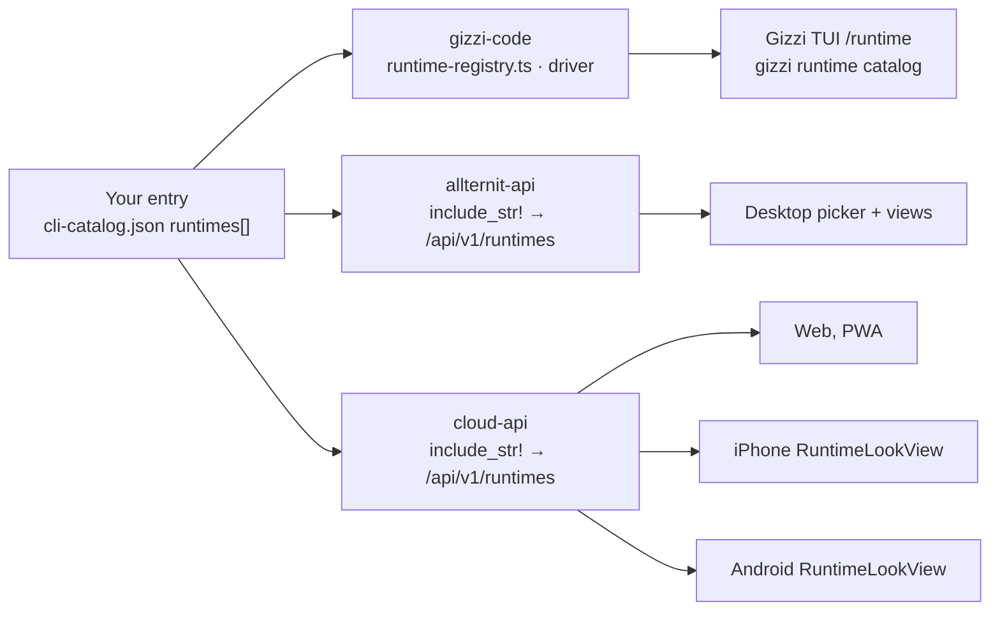

A runtime is one entry in one file. Add it there and it appears in the picker on Desktop, ai.allternit.com, the PWA, the iPhone and Android apps and Gizzi Code, with its own Runtime view, and it is served by [`GET /api/v1/runtimes`](/api/runtimes). There is no second list to update.



Both servers build the file into their binary, so a new runtime ships with the next release. Clients cache the last good copy and fall back to a built-in list when the server can't be reached.

## Before you start

- The runtime needs a CLI. If it is not in the catalog yet, add a `tools[]` entry first (id, binary, sign-in, install). See [Add a connection](/build-on-allternit/add-a-connection).
- An LLM-only CLI (one with no agent loop, such as `llm`) is a brain, not a runtime. Leave it in `tools[]` with category `llm`.

## 1. Write the registry entry

File: `cmd/gizzi-code/src/runtime/providers/discovery/cli-catalog.json`, array `runtimes`, catalog `version` 3.

```json
{
  "id": "kimi",
  "name": "Kimi Code",
  "vendor": "Moonshot AI",
  "category": "coding",
  "tool": "kimi-cli",
  "aliases": ["kimi-cli"],
  "adapter": { "kind": "acp" },
  "brains": "any",
  "access": ["plan", "key"],
  "more": false,
  "systemLayer": { "via": "acp-session" },
  "look": { "default": "terminal", "terminal": { "kind": "tui", "bg": "#131314", "fg": "#ececec", "mu": "#8a8a8a", "ac": "#1783ff" } },
  "docs": "https://www.kimi.com/"
}
```

### Fields

| Field | Required | What it is |
|---|---|---|
| `id` | yes | The runtime id. Use the old native harness id when one exists (`claude`, `codex`, `kimi`), otherwise the tool id. Saved in `botBrain.runtime`. |
| `name`, `vendor` | yes | Shown in every picker. |
| `category` | yes | `native`, `coding`, `personal`, `general` or `experimental`. Sets the picker group. |
| `tool` | yes | The `tools[].id` of its CLI, or `null` (only `allternit`). |
| `aliases` | no | Other ids that resolve to it, such as `agy` for `antigravity`. Must not repeat any id or alias. |
| `adapter` | yes | `{kind, argv?}`: how Allternit drives it. See [Adapter kinds](#adapter-kinds). |
| `brains` | yes | `"any"`, or a list of provider ids it can run (`["anthropic", "claude"]`). |
| `access` | yes | Any of `plan`, `key`, `local`, `credits`. |
| `more` | yes | `true` puts it under **More** in pickers. |
| `status` | no | `{label, tone}`, `tone` is `warn` or `info`. Shown as a note, for example `{"label": "API key or Enterprise only", "tone": "warn"}` on Gemini CLI. |
| `systemLayer` | yes | `{via}`: how the Allternit layer is added. See [System layer](#2-pick-the-system-layer). |
| `look` | yes | `{pack?, default, terminal?, desktop?}`: the Runtime view. See [Look tokens](#3-add-look-tokens). |
| `liveUi` | no | `{argv, port, health, label}`: the runtime's own web app. See [Live web app](#4-optional-a-live-web-app). |
| `legacy` | no | `{harness?, uhp?}`: old ids that map to this runtime when the server fills in an old bot record. |
| `docs` | no | The vendor's docs URL. |

### Brain compatibility

A brain fits when `brains` is `"any"` or the brain's provider is in the list. The check accepts a vendor id (`anthropic`), a subscription id (`subs-anthropic`) or a CLI provider id (`claude-cli`), and a runtime always runs its own CLI's models (its `tool`, id and aliases). When a brain doesn't fit, clients switch to the runtime CLI's default model and show one line. gizzi's `runtime-registry.ts` is the reference for this rule; every client uses the same one.

## Adapter kinds

| `adapter.kind` | What the driver does | Live tool steps | Broker |
|---|---|---|---|
| `native` | Allternit's own loop in gizzi. | yes | yes |
| `acp` | Starts an Agent Client Protocol session (`session/new`, `session/prompt`). | yes | yes, through `session/request_permission` |
| `stream-json` | Reads the CLI's JSON event stream. | yes | only when the CLI has a permission channel (Claude Code's `--permission-prompt-tool`) |
| `codex-app-server` | Codex's own app-server protocol. | yes | yes, through its approval requests |
| `gateway` | Talks to a running service (OpenClaw's Gateway). | yes | no |
| `one-shot-json` | Runs one prompt and reads a JSON result. | no | no |
| `text` | Runs one prompt and reads plain text. | no | no |
| `unsupported` | Listed, not driven. | no | no |

`acp` and `stream-json` runtimes also need a `CLI_ADAPTERS` key for their `tool` in `cmd/gizzi-code/src/runtime/drivers/local-cli-driver.ts`. Prefer ACP when the CLI has it: you get live steps and the broker with no CLI-specific code.

## 2. Pick the system layer

`systemLayer.via` says how Allternit adds its layer. The driver only ever appends; the vendor's own prompt stays.

| `via` | Use when |
|---|---|
| `append-flag` | The CLI has its own append channel (Claude Code `--append-system-prompt`, Codex developer instructions). |
| `acp-session` | The runtime speaks ACP. The layer leads the first prompt of the turn. |
| `agents-md` | Text CLIs that read `AGENTS.md`. Today the layer leads the message. |
| `plugin` | Reserved. Falls back to the message. |
| `none` | No layer (Allternit itself, unsupported runtimes). |

See [System layers](/concepts/system-layers) for how each one is applied and which runtimes are brokered. If your runtime has no permission channel, say so in its docs: it runs under its own permissions and Allternit can't stop a tool call.

## 3. Add look tokens

The Runtime view is drawn from data, so the web renderer and the native `RuntimeLookView` on iPhone and Android draw the same thing. A token set:

```json
{
  "kind": "tui",
  "bg": "#1a1918", "fg": "#e8e6e1", "mu": "#8d8a84", "ac": "#d97757", "ok": "#5fb57a",
  "light": { "bg": "#fbfbfa", "fg": "#1d1d1b", "mu": "#74746f", "ac": "#d97757" },
  "banner": [
    [["Claude Code v2.1", "b"]],
    [["~/project", "mu"]]
  ],
  "userStyle": "plain",
  "prompt": "❯",
  "answerGlyph": "⏺",
  "steps": {
    "Read": [[["⏺ ", "ok"], ["Read(", "b"], ["{a}", "fg"], [")", "b"]], [["  ⎿  ", "mu"], ["Read {r}", "mu"]]],
    "Edit": [[["⏺ ", "ok"], ["Update(", "b"], ["{a}", "fg"], [")", "b"]], [["  ⎿  ", "mu"], ["Updated {a} with {r}", "mu"]]],
    "Run":  [[["⏺ ", "ok"], ["Bash(", "b"], ["{a}", "fg"], [")", "b"]], [["  ⎿  ", "mu"], ["{r}", "mu"]]]
  },
  "input": "line",
  "inputGlyph": "❯",
  "placeholder": "Try \"refactor <filepath>\"",
  "footer": { "l": [["  ? for shortcuts", "mu"]], "r": [["high", "fg"], [" · /effort", "mu"]] }
}
```

- **Colors**: `bg`, `fg`, `mu` (muted), `ac` (accent), optional `ac2`, `ok`, `err`. `light` overrides them for light mode; `dark: true` marks a look whose real screen is dark.
- **A Line** is a list of `[text, role]` segments. Roles: `fg`, `mu`, `ac`, `ac2`, `ok`, `err`, `b` (bold), `pill`.
- **Slots**: in `steps`, `{a}` is the step's argument (a path, a command) and `{r}` its result ("42 lines", "12 passed").
- **Steps**: one entry each for `Read`, `Edit` and `Run`. `pre` adds lines before the steps (Hermes "Thought for 3s"); `stepBox: true` draws them in a box.
- **Banner**: `banner` lines, with `bannerBox` and `boxRole` for a box around them.
- **Input and footer**: `input`, `inputGlyph`, `placeholder`, and `footer` slots `l`, `m`, `r`.
- **Desktop looks** use `kind: "app"` and add `header` and `status`.

Set `look.default` to `terminal` or `desktop`; that side must have tokens (except `allternit`). `look.pack` names a TypeScript look pack for extra drawing on the web; the tokens must still stand on their own for the phone apps. Renderers ignore fields they don't know.

Check the look against the real screen side by side before you ship it, and note in the PR whether the reference was the installed CLI or a public screenshot.

## 4. Optional: a live web app

If the runtime ships its own web app, add `liveUi`:

```json
"liveUi": { "argv": ["opencode", "serve"], "port": 4096, "health": "/", "label": "OpenCode web app" }
```

allternit-api starts it on the user's computer (`cmd/allternit-api/src/runtime_live.rs`), bound to that computer only, in the session's folder, waits up to 20 seconds for `health` to answer, and returns a `ui://allternit/live-app` resource that Desktop shows in the MCP Apps frame. If the app can't be bound to the computer (OpenHands runs in Docker on a fixed port), the route answers `501 live_unsupported` and apps show the look. Add the binding flags your CLI needs in `runtime_live.rs`.

## 5. Check it

```bash
cd cmd/gizzi-code
bun script/check-runtime-registry.ts
```

It is a quick consistency check, not a build. It fails when:

- a non-LLM tool has no runtime;
- an id or alias repeats;
- an `acp` or `stream-json` runtime has no `CLI_ADAPTERS` key;
- `tool` points to a missing `tools[].id`;
- a Line uses an unknown role, or `look.default` has no tokens.

Then add the runtime to the [Runtimes](/guides/runtimes) catalog table and, if it is brokered or not, to the table in [System layers](/concepts/system-layers).

## The endpoints

| Route | Server | Auth | Returns |
|---|---|---|---|
| `GET /api/v1/runtimes` | allternit-api and cloud-api | none | `{version, runtimes}`, with ETag and `Cache-Control: public, max-age=3600`. On your own computer, the owner also gets `installed: {id: {installed, signedIn, version}}`. |
| `POST /api/v1/runtimes/:id/live` | allternit-api | owner only | `{url, resourceUri}` |
| `GET /api/v1/runtimes/:id/live` | allternit-api | owner only | The running app, if any |
| `DELETE /api/v1/runtimes/:id/live` | allternit-api | owner only | Stops the app |

Full shapes and errors: [Runtimes API](/api/runtimes).

## Related

- [The agent model](/concepts/agent-model)
- [Runtime views](/guides/runtime-views)
- [gizzi runtime](/cli/runtime)
- [Conformance checklist](/build-on-allternit/conformance-checklist)
