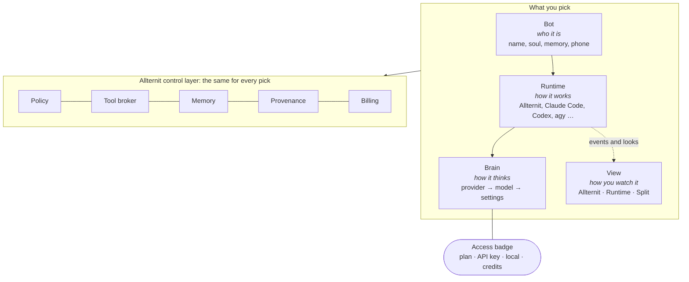

Any runtime, any brain, any bot, in one workspace, under one set of rules.

That sentence is the whole model. An agent in Allternit is not one product with one model inside it. It is four parts you pick separately, and one layer of rules that stays the same whatever you pick.

| Part | Question it answers | Examples |
|---|---|---|
| **Runtime** | How does it work? | Allternit, Claude Code, Codex, Antigravity, Kimi Code, OpenCode, Hermes, OpenClaw: 36 in the [catalog](/guides/runtimes) |
| **Brain** | How does it think? | Claude Sonnet 5, GPT-6, Gemini, Kimi K3, a local Qwen model |
| **Bot** | Who is it? | Your research assistant, your reviewer, a ChatGPT GPT you connected |
| **View** | How do you watch it? | The Allternit view, the runtime's own view, or both side by side |

Under all four is the [control layer](/concepts/control-layer): policy, the tool broker, memory, provenance and billing. It is the part Allternit owns, and it does not change when you change any of the four.

## The layer graph



Read it from the top. You choose who the agent is (the bot), how it works (the runtime) and what it thinks with (the brain). Whatever the runtime does comes back as events that any view can draw. Every tool call, every memory write and every charge goes through the control layer below.

## Runtime: how it works

A runtime is the agent program that runs the loop: it reads files, calls tools, plans and writes the answer. Claude Code, Codex, Kimi Code and Antigravity are runtimes. So is **Allternit**: our own runtime is one entry in the same catalog, next to the others, with no special path through the picker.

Every runtime is one entry in one registry, the `runtimes` array of `cli-catalog.json`. Desktop, ai.allternit.com, the PWA, the iPhone and Android apps and Gizzi Code all read that registry (from [`GET /api/v1/runtimes`](/api/runtimes) or straight from the file), so every surface offers the same choices. See [Runtimes](/guides/runtimes) for the catalog and [Add a runtime](/build-on-allternit/add-a-runtime) for the entry format.

## Brain: how it thinks

The brain is the model. You pick it in three steps: the provider, the family and model, then settings such as effort. Each brain carries an **access badge** that says how it is paid for: your **plan** (a subscription you already have), your **API key**, a **local** model on your computer, or Allternit **credits**.

Access belongs to the brain, not to the runtime. The same Claude Sonnet can run on your Claude plan inside Claude Code, or on credits inside Allternit. See [Brains and access](/guides/brains-and-access).

Some runtimes run any brain. Others run only their own vendor's models: Claude Code runs Anthropic models, Codex runs OpenAI models. When you pick a runtime that can't run the brain you had, the brain switches to one that fits and a one-line note says so.

## Bot: who it is

The bot is the identity: its name and avatar, its soul and user files, its memory, its phone and mailbox, its routines and its autonomy settings. A bot keeps all of this when you move it to a different runtime or brain.

There are two kinds of bot:

- **Allternit bots.** You pick their runtime and brain.
- **[Connected bots](/guides/connected-bots).** A bot that lives on a vendor platform you already use, such as a Claude Project, a ChatGPT GPT or a Gemini Gem. The vendor runs it, so its runtime and brain show as **Run by** the vendor and are locked.

## View: how you watch it

The same session can be drawn in more than one way:

- **Allternit view.** Our chat: the request, each tool step as a checked line, the answer and a provenance line.
- **Runtime view.** The session drawn the way the runtime draws it: Claude Code's terminal, Codex's terminal, Goose's desktop app.
- **Split.** Both side by side, on wide screens.

A runtime with a web app of its own (OpenCode, OpenClaw, Aider) can also open that app live inside Allternit on Desktop. See [Runtime views](/guides/runtime-views).

<Frame caption="One session, two views. Left: the Runtime view in Claude Code's look. Right: the Allternit view, with the line that says it ran on Claude Code, that three tool calls passed policy and that it was saved to the record.">
  
</Frame>

## Why the parts are separate

Most agent products tie the four together. The vendor's runtime runs the vendor's model, with the vendor's memory, in the vendor's window. Changing one means leaving the rest.

Keeping them apart has concrete effects:

- **You keep what you pay for.** A Claude, ChatGPT, Kimi or Google plan works through its own runtime, and Allternit draws and records the work.
- **You keep the runtime's prompt.** Each runtime keeps the system prompt its vendor tuned. Allternit only appends its layer. See [System layers](/concepts/system-layers).
- **Rules don't depend on the model.** Policy is enforced by the tool broker in code, not by asking the model to behave. A prompt is not a boundary.
- **The record is one record.** Every run, whatever the runtime, lands in the same thread history, memory and usage records.

## How it is stored

A bot's runtime, brain and view live in its agent record. All fields are optional and additive, so older apps keep working:

```json
{
  "botBrain": {
    "mode": "native_harness",
    "harness": "claude",
    "runtime": "claude",
    "modelRef": "claude-cli/claude-sonnet-5-5",
    "access": "plan"
  },
  "agentView": { "view": "runtime", "look": "terminal" }
}
```

`GET /agents/:id` adds a read-only `botKind`: `allternit`, or `connected` when the bot has a vendor binding. See [Runtimes API](/api/runtimes#bot-record-fields) for every field and how the server fills in the ones an older app leaves out.

## Related

- [Control layer](/concepts/control-layer)
- [System layers](/concepts/system-layers)
- [Runtimes](/guides/runtimes)
- [Agent card](/guides/agent-card)
