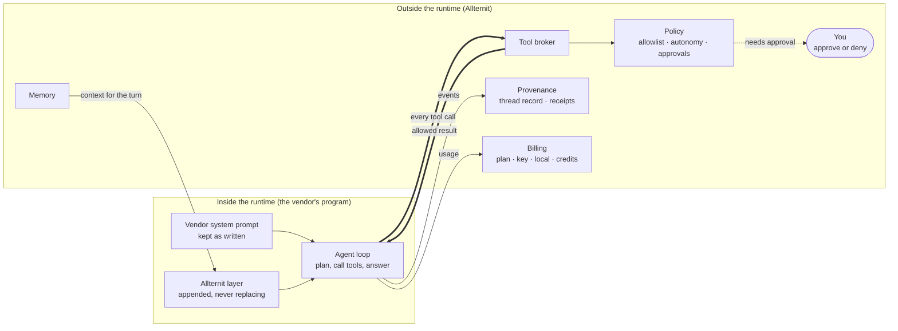
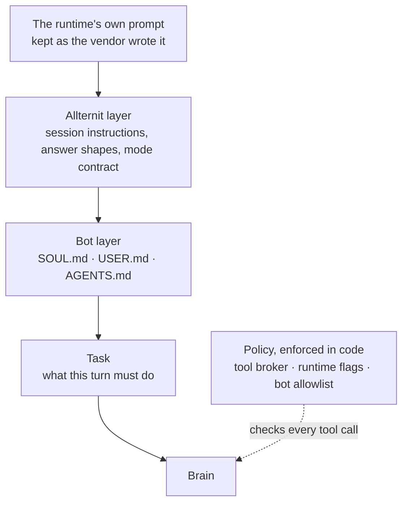

You can run a bot on Allternit's own runtime, on Claude Code, on Codex, on Antigravity or on any of the other runtimes in the [catalog](/guides/runtimes). The runtime changes how the work is done. The **control layer** does not change. It is the same five pieces under every runtime, every brain and every bot:

| Piece | What it does |
|---|---|
| **Policy** | Decides what a bot may do: its tool allowlist, its [autonomy](/guides/bot-autonomy) level, and which actions need your approval first. |
| **Tool broker** | Answers each tool call a runtime wants to make, before it runs. It applies policy, or asks you. |
| **Memory** | Keeps what the bot knows about you and its work, in Allternit, so it stays when you switch runtime or brain. See [Memory](/guides/memory). |
| **Provenance** | Records what ran, where, with which brain, and which tool calls passed policy. Every run lands in the same thread history. |
| **Billing** | Counts usage per brain and access: work on your plan or your key is yours; work on credits is charged by Allternit. See [Usage](/guides/usage-dashboard). |

## Inside the runtime, outside the runtime

A runtime is a program made by someone else. Allternit does not change it. It starts the runtime, gives it a session, adds its own layer to the prompt, and stands between the runtime and everything with side effects.

What stays **inside** the runtime:

- The agent loop and how it plans.
- The vendor's own system prompt, which Allternit keeps.
- The runtime's own settings and the files it reads, such as its `AGENTS.md`.

What stays **outside**, in Allternit:

- The decision on every tool call (the broker and policy).
- Your approvals. Allternit never approves a request on your behalf.
- Memory, the thread record and the usage records.

## A prompt is not a boundary

A model can ignore an instruction, forget it, or be talked out of it. So the control layer does not ask the model to keep the rules. It enforces them where the tool runs:

1. The runtime asks to run a tool: for example, to write a file or run a shell command.
2. The request reaches the tool broker. On Claude Code it arrives through `--permission-prompt-tool`; on Codex through its approval requests; on ACP runtimes such as Kimi Code and Antigravity through `session/request_permission`.
3. The broker checks policy. An allowed call runs. A call that needs approval waits for you. A refused call goes back to the runtime as refused.
4. The result, allowed or not, is recorded.

The prompt still explains the rules to the model, so it does not waste turns asking for things it can't have. But the broker is what holds the line.

<Note>
Not every runtime has a permission channel. Runtimes started with their own auto-approve or skip-permissions flag, and one-shot text runtimes, never ask before a tool runs. Those runtimes work in the session's folder with their own permissions. The table in [System layers](/concepts/system-layers#which-runtimes-are-brokered) lists which runtimes are brokered. Pick a brokered runtime for a bot that must ask before it writes.
</Note>

## How the layer stacks

The control layer adds one layer to each runtime's prompt and enforces the rest beside it:

Each runtime entry says how the Allternit layer is added (`systemLayer.via`): through the runtime's own append flag, at the start of an ACP session, ahead of the message, or not at all. The full table is in [System layers](/concepts/system-layers).

## Provenance you can see

Every run in the Allternit view ends with one line that states where it ran and what the control layer did:

<Frame caption="The provenance line under an answer: the runtime it ran on, how many tool calls passed policy, and that the run was saved to the record.">
  
</Frame>

The same record backs the thread history, the [Needs you](/guides/needs-you-inbox) inbox for approvals, and the usage page.

## For connected bots

A [connected bot](/guides/connected-bots) runs on its vendor's platform, so its runtime and brain are the vendor's. The control layer still covers everything it does through Allternit: the tickets it gets, the approvals on its phone and mailbox tools, and the audit row written for each tool call. See [How connected bots connect](/guides/how-connected-bots-connect).

## Related

- [The agent model](/concepts/agent-model)
- [System layers](/concepts/system-layers)
- [Policy](/architecture/policy)
- [Receipts](/architecture/receipts)
- [Bot autonomy](/guides/bot-autonomy)
