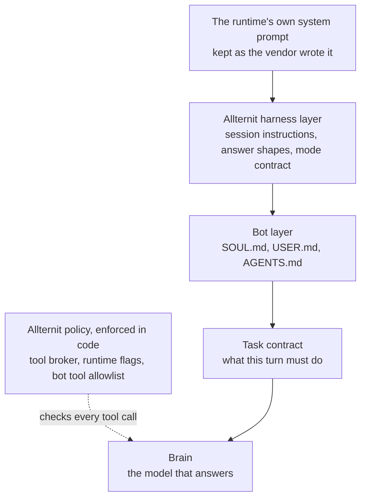

A bot runs on a runtime: Allternit's own, or a coding CLI such as Claude Code, Codex, Kimi or Gemini CLI. Every runtime ships with its own system prompt, tuned by its vendor. Allternit keeps that prompt. It adds its own layer on top and enforces its rules outside the runtime.

## The layer stack

From the bottom of the prompt up:

1. **The runtime's own prompt.** Claude Code, Codex and the others keep their base instructions. Allternit never replaces them.
2. **Allternit harness layer.** The session's instructions: answer shapes, the plan or build mode contract, and how to use gizzi's session tools.
3. **Bot layer.** The bot's own workspace files (SOUL.md, USER.md, AGENTS.md), which allternit-api puts into the bot's persona text.
4. **Task contract.** What this turn asks for.
5. **Brain.** The model the user picked runs with all of the above.

Policy sits beside the stack, not inside it. It is code that answers each tool call.

## A prompt is not a boundary

A model can ignore, forget or be talked out of any instruction. So Allternit does not rely on the prompt to keep a bot inside its limits. The rules that matter are enforced where the tool runs:

- **The tool broker.** When a runtime asks to run a tool, gizzi answers. A bot's allowlist and approval gates decide, or the caller asks its user (the Gizzi terminal's permission prompt). ACP runtimes also pass the Allternit spawn gate first.
- **Runtime flags.** Claude Code bot turns run with settings isolation and the bot's tool allowlist, not with Claude's skip-permissions mode. Plan and tools-off turns on Codex run in its read-only sandbox.

The prompt explains the rules to the model. The broker and the flags enforce them.

## How each runtime gets the layer

Each runtime entry in the [runtime registry](/api/runtimes) says how its layer is added, in `systemLayer.via`. The driver reads it with `systemLayerVia()` (`cmd/gizzi-code/src/runtime/drivers/cli-session-flags.ts`) and only ever appends.

| `systemLayer.via` | What the driver does | Runtimes |
|---|---|---|
| `append-flag` | Uses the runtime's own append channel. Claude Code gets `--append-system-prompt`, bot turns included. Codex gets developer instructions, which sit on top of its base instructions. | Claude Code, Codex |
| `acp-session` | ACP has no system prompt field, so the layer leads the first prompt of the turn in a `session_instructions` block. | Kimi, Antigravity, Grok, Hermes, Kiro, Qoder, Qoder CN, Trae, QwenPaw, Reasonix, MiniMax Code |
| `agents-md` | Gizzi has no AGENTS.md writer yet, so the layer leads the message in a `session_instructions` block. The runtime still reads its own AGENTS.md. | Qwen Code, Cursor Agent, OpenCode, CodeBuddy, DevEco, OpenClaw, Pi, Oh-My-Pi, Gemini CLI and the other text CLIs |
| `plugin` | No runtime uses a plugin hook yet. It would fall back to the message. | none today |
| `none` | No layer. | Allternit (its own prompt is built in gizzi), DSH (not supported) |

When a turn runs on an adapter with no channel, the layer goes into the message instead. An example is Antigravity's `--print` fallback when its ACP start fails. The layer is never sent twice and never dropped.

## Which runtimes are brokered

"Brokered" means each tool call the runtime wants to make reaches gizzi's broker before it runs. `toolCallsBrokered()` in the same file records this per runtime.

| Runtime | Permission channel | Brokered |
|---|---|---|
| Claude Code | `--permission-prompt-tool stdio`: each `can_use_tool` request goes to the broker. Plan turns send what plan mode asks about to gizzi's bridge. | Yes |
| Codex | Exec and file-change approval requests go to the broker. While a caller approves tools, Codex runs with approval policy `on-request`. | Yes |
| ACP runtimes (Kimi, Antigravity, Hermes, Kiro, QwenPaw, Reasonix, MiniMax Code) | `session/request_permission` goes to the spawn gate, then to the caller. | Yes |
| Grok, Qoder, Qoder CN, Trae | Started with their own auto-approve flag (`--always-approve`, `--yolo`), so they never ask. | No |
| Qwen Code, Cursor Agent, OpenCode, CodeBuddy, DevEco | Started with their own skip-permissions flag. | No |
| OpenClaw, Pi, Oh-My-Pi | One-shot JSON runs with no permission hook. | No |
| Gemini CLI and the other text CLIs, Antigravity's print fallback | One-shot text runs with no permission hook. | No |

Gizzi cannot stop a tool call on a runtime that is not brokered. Those runtimes work in the session's folder with their own permissions, so pick a brokered runtime for a bot that must ask before it writes. When a caller that approves tools picks one of them, gizzi logs that its tools are not brokered. On a brokered runtime, gizzi never accepts a request on the caller's behalf while the caller approves tools.

## Related

- [Runtimes API](/api/runtimes)
- [System prompts](/core/system-prompts)
- [Native sessions](/cli/native-sessions)
- [Bot autonomy](/guides/bot-autonomy)
