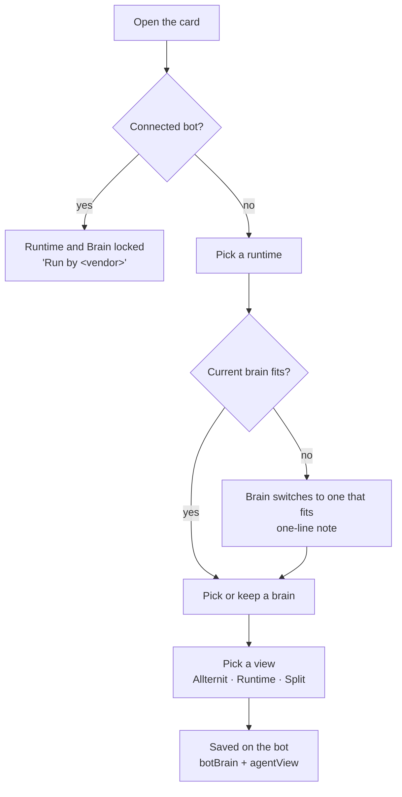

The **agent card** is where you choose the parts of [the agent model](/concepts/agent-model) for a bot. It has one row per part:

1. **Runtime**: how it works.
2. **Brain**: how it thinks.
3. **Bot**: who it is.

Under the three rows, the card names the [control layer](/concepts/control-layer) that applies to every choice (policy, tool approvals, memory, provenance, billing), and one sentence says what the result will be: "Raven works with Hermes and thinks with Claude Sonnet 5, with your Claude Code sign-in."

## Where it appears

| Where | What you see |
|---|---|
| A bot's page (bot settings) | The full card |
| **New agent** / Create bot | The full card, as the first block under **More options** |
| The chat composer (every chat, and the Code composer) | Compact chips: one per row, each opening the same choices |
| Settings › Connections › **Runtimes** | Every runtime, with a detail view and **New chat on** / **New bot on** |
| Bots home, before your first bot | A **Pick how your bot works** card that opens Create bot with this card first |

The card reads the same runtime list on every surface, from the [runtime registry](/api/runtimes). If the list can't be loaded, it uses the copy built into the app and says so.

## The full card: List, Grid and Deck

Closed, each row shows the current choice as a chip. Open a row and its choices show in the layout you pick with the switch next to search: **List**, **Grid** or **Deck**. These are the same three layouts as the [Connections](/guides/connections) page. Search works across runtimes, brains and bots.

<CardGroup cols={3}>
  <Frame caption="Grid: tiles with the runtime's mark, category and which brains it runs.">
    
  </Frame>
  <Frame caption="List: one row per runtime, with category and vendor.">
    
  </Frame>
  <Frame caption="Deck: cards that scroll sideways, with the Brain and Bot rows below.">
    
  </Frame>
</CardGroup>

Runtimes are grouped by category: Native, Personal, Coding, General, Experimental. Each one shows which brains it runs ("Any brain", "Anthropic models", "OpenAI models"). A runtime under **More** opens from the **More** row or when you type a filter. A runtime whose CLI isn't installed on your computer still shows, so you can see it and set it up.

The brain row only lists brains that fit the runtime. Each brain shows its access badge: Plan, Key, Local or Credits. See [Brains and access](/guides/brains-and-access).

## Compact chips in chat

Every chat has the chips, so you can see and change how a chat works even with no bots and no computer.

- **A bot chat** shows three chips: runtime, brain, bot.
- **A plain chat** shows two: runtime (Allternit unless the chat runs on another runtime) and brain (the model picker).
- **The Code composer** shows the same two chips, with the Coding runtimes listed first.

Picking another runtime starts a new chat (or Code session) on it and carries over what you had typed. Allternit never quietly falls back to another runtime. If the runtime can't start, the list stays open with one line and a button:

| What's wrong | What you see |
|---|---|
| No computer online | "Claude Code runs on a computer. Pair a computer to use it." with **Pair a computer** |
| The CLI isn't on your computer | "Claude Code isn't installed on Sam's Mac." |
| You are signed out | "Sign in to use Claude Code." with **Sign in** |
| The server refuses (brain or plan not allowed on that runtime) | The server's own message, for example "Claude's plan can't be used inside OpenCode. Use an API key, or pick Claude Code." |

<Frame caption="A plain chat on Codex: the runtime chip beside the brain.">
  
</Frame>

<Frame caption="A bot chat with the brain list open (left) and the runtime list open, grouped by category (right).">
  
</Frame>

## Create bot: Runtime and Brain first

In **Create bot**, the card is the first thing under **More options**, above instructions, tools and the bot's computer. Opened from **New bot on &lt;Runtime&gt;** or **Pick how your bot works**, Create bot opens **More options**, scrolls to the card, and picks the runtime for you when one was chosen. The phone sheet does the same.

## How a pick flows



## Connected bots are locked

A [connected bot](/guides/connected-bots) runs on its vendor's platform, such as a ChatGPT GPT or a Claude Project. The vendor picks its runtime and brain, so both chips read **Run by** and the vendor's name, with a lock. The sentence under the card says so: "Dots is run by OpenAI. Allternit shows its work and keeps the record."

<Frame caption="A connected bot in chat: runtime and brain read 'Run by OpenAI' and can't be changed.">
  
</Frame>

## On each surface

<Tabs>
  <Tab title="Desktop">
    The full card on the bot page and in **New agent**, with List, Grid and Deck. Compact chips in the chat composer. Desktop reads the runtime list from your computer, so it also knows which CLIs are installed and signed in.
  </Tab>
  <Tab title="ai.allternit.com and phone layout">
    The same card. On a phone-width screen, Grid uses 2 columns, every target is at least 44 px, and Split is not offered. The runtime list comes from Allternit Cloud, so the card works with no computer.
  </Tab>
  <Tab title="m.allternit.com app">
    The same build as the phone layout, sized for touch.
  </Tab>
  <Tab title="iPhone">
    The layers are part of the existing screens, not a new tab: the bot form's brain sheet holds Runtime, Brain and Bot, and the chat's model sheet holds the compact chips. The bot thread has the **Runtime · Allternit** view switch.
  </Tab>
  <Tab title="Android">
    The same rows as iPhone, in the bot form and the model picker, with the **Runtime · Allternit** view switch in the bot thread. The two apps are checked side by side, with no Android-only rows.
  </Tab>
  <Tab title="Gizzi Code">
    `/runtime` in the TUI opens the Runtime then Brain layers, with access badges `[plan]`, `[key]`, `[local]`, `[credits]`. On the command line:

    ```bash
    gizzi runtime catalog
    gizzi agents bot create coder --runtime codex
    gizzi agents bot create reviewer --runtime claude --brain claude-cli/claude-sonnet-5-5
    gizzi agents bot edit reviewer --runtime claude
    ```

    A connected bot refuses `--runtime` and `--brain`. See [gizzi runtime](/cli/runtime) and [gizzi agents bot](/cli/bot).
  </Tab>
</Tabs>

## What is saved

| Choice | Saved as |
|---|---|
| Runtime | `botBrain.runtime` (older apps keep reading `mode` and `harness`, which the server fills in from it) |
| Brain | `botBrain.modelRef` |
| Access | `botBrain.access` |
| A brain switched for you | `botBrain.autoSwitchedFrom` |
| View | `agentView.view` and `agentView.look` |

See [Runtimes API](/api/runtimes#bot-record-fields).

## Related

- [Runtimes](/guides/runtimes)
- [Brains and access](/guides/brains-and-access)
- [Runtime views](/guides/runtime-views)
- [Connected bots](/guides/connected-bots)
