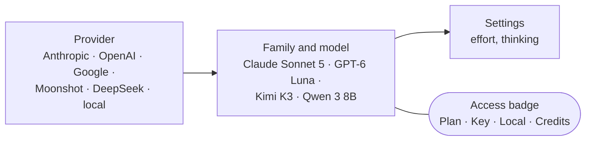
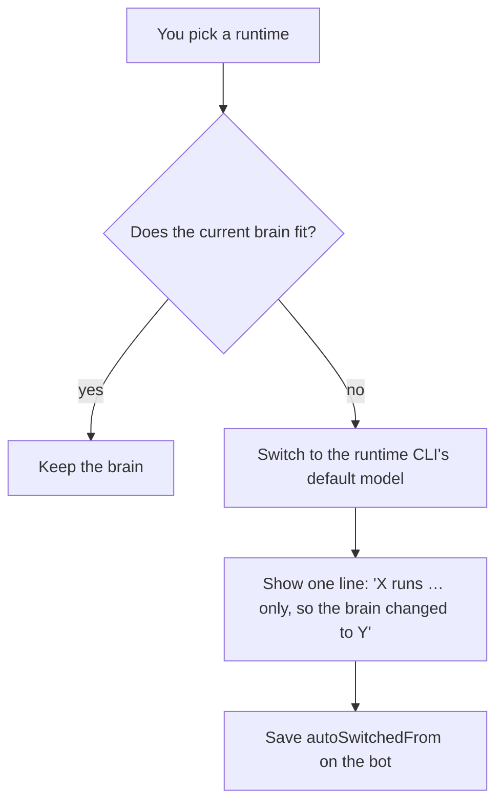
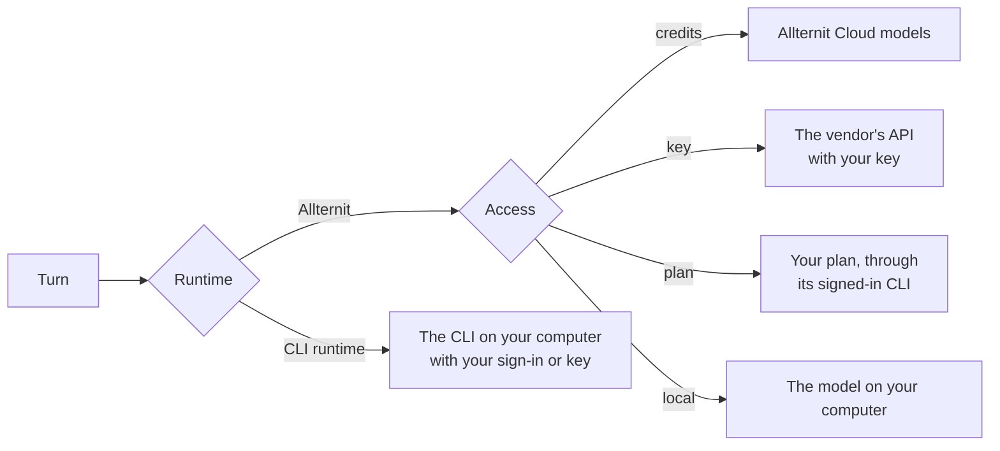

The **brain** is the model a bot thinks with. It is the **Brain** part of [the agent model](/concepts/agent-model), picked separately from the [runtime](/guides/runtimes) (how the bot works) and the bot (who it is).

## Picking a brain

A brain is picked in three steps:



1. **Provider**: who makes the model.
2. **Family and model**: which model.
3. **Settings**: options the model supports, such as effort.

Each brain in the list has a line under its name that says how it will run, for example "With your Claude Code sign-in", "On this computer" or "With Allternit credits", and a badge.

<Frame caption="The brain list in a bot chat. Each row has its access badge: Plan, Local or Credits. The line at the bottom says what the result will be.">
  
</Frame>

## Access: how a brain is paid for

| Badge | What it means | Needs |
|---|---|---|
| **Plan** | A subscription you already pay for: Claude, ChatGPT, Kimi, Google, GitHub Copilot and others. It runs through that vendor's own CLI, signed in as you. Its limits are your plan's limits. | The vendor's CLI signed in, on a computer you link. See [Use your plan](/guides/use-your-plan). |
| **Key** | Your own API key from the vendor. The vendor bills you. | The key, saved in **Settings → Connections**. |
| **Local** | A model that runs on your computer. Nothing leaves it. | A linked computer with the model. See [Open models](/guides/open-models). |
| **Credits** | Allternit Cloud models, paid from your Allternit credits. | Nothing else. Works with no computer. See [Credits](/guides/credits-and-auto-top-up). |

Access belongs to the brain, not the runtime. The same model can show up more than once: Claude Sonnet 5 on your Claude plan, and on credits. Pick the row you want to pay with. The bot remembers the choice (`botBrain.access`).

Each runtime lists the access it supports in the registry. Claude Code supports plan and key. OpenCode supports plan, key and local. The Allternit runtime supports all four. See the [catalog](/guides/runtimes#the-catalog).

## Which brains fit which runtime

Most runtimes run any brain. A few run only their own vendor's models:

| Runtime | Runs |
|---|---|
| Claude Code | Anthropic models |
| Codex | OpenAI models |
| Every other runtime | Any brain it can reach, including its own CLI's models |

The rule every surface uses is the same: **a brain fits a runtime when the runtime runs any brain, or when the brain's provider is in the runtime's list.** A runtime always runs its own CLI's models, so a Kimi Code brain always fits Kimi Code.

The brain list only shows brains that fit the runtime you picked.

## When you switch runtime

If you pick a runtime that can't run the brain you had, the brain changes to one that fits, and a one-line note says so:

> Codex runs OpenAI models only, so the brain changed to GPT-6 Luna.



The new brain is the default model of the runtime's own CLI. The bot record keeps `botBrain.autoSwitchedFrom` so every surface can show the same note. Nothing switches without telling you.

<Frame caption="The note after picking Codex for a bot that had a Claude brain.">
  
</Frame>

## Routing: where a turn goes

Once runtime, brain and access are set, a turn goes one of four ways:



- **No computer linked?** Credits and keys work from the web and phones. Plans also work with no computer for the providers that allow it; see [Use your plan](/guides/use-your-plan). CLI runtimes need a computer.
- **A brain that isn't ready** (signed out, or out of plan limits) stops and tells you. It does not quietly move to another brain unless you set a fallback. See [Keep a bot answering](/guides/always-on-bots).
- **The control layer is the same on every route.** Policy, the tool broker, memory and the usage record apply whichever way the turn goes. See [Control layer](/concepts/control-layer).

For the routing design underneath (execution modes and the model pool), see [Routing](/architecture/routing).

## In the terminal

```bash
gizzi agents bot edit reviewer --runtime claude --brain claude-cli/claude-sonnet-5-5
```

`--model` still works as another name for `--brain`. In the TUI, `/runtime` shows each brain with `[plan]`, `[key]`, `[local]` or `[credits]`. See [gizzi runtime](/cli/runtime) and [gizzi agents bot](/cli/bot).

## Related

- [Agent card](/guides/agent-card)
- [Runtimes](/guides/runtimes)
- [Subscriptions](/guides/subscriptions)
- [Runtimes API](/api/runtimes#bot-record-fields)
