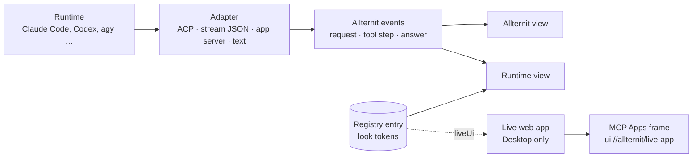

Every runtime draws its work differently. Claude Code has its orange-bordered welcome box and `⏺` tool lines. Codex has its `>_` header and "Explored / Edited / Ran" steps. Goose has a desktop app with tool rows in a box. In Allternit you can watch any bot's session the way its runtime draws it, the Allternit way, or both at once.

This is the **View** part of [the agent model](/concepts/agent-model). It changes how a session is drawn, never what runs.

## The three views

| View | What you see | Where |
|---|---|---|
| **Allternit** | Our chat: your request, each tool step as a checked line, the answer, and the provenance line ("Ran on Claude Code · 3 tool calls passed policy · saved to the record"). | Every surface |
| **Runtime** | The same session in the runtime's own look: its banner, prompt glyph, step lines, input box and footer. | Every surface |
| **Split** | Both, side by side. | Screens 900 px wide and over |

Switch with the **Runtime · Allternit · Split** control at the top of a bot's session. The choice is saved on the bot (`agentView.view`), so it opens the same way next time and on your other devices. Split is hidden on screens under 900 px wide, which covers phones and the PWA; a bot saved as Split opens in the Runtime view there.

<Frame caption="Split on Desktop: Claude Code's terminal look on the left, the Allternit view of the same run on the right.">
  
</Frame>

## How one session becomes every view

1. The [adapter](/build-on-allternit/add-a-runtime#adapter-kinds) turns what the runtime does into Allternit events: one request, each tool step, one answer.
2. The Allternit view draws those events in our style.
3. The Runtime view draws the **same events** with the runtime's **look tokens** from the registry: colors, banner lines, the prompt glyph, how a Read, Edit or Run step is written, the input box and the footer.

Because the look is data in the registry, not code in one app, every renderer draws it the same way: the web renderer on Desktop, ai.allternit.com and the PWA, and the native `RuntimeLookView` on iPhone and Android.

## Terminal looks and desktop looks

Every runtime with a screen of its own has a **terminal look**: it copies the runtime's terminal (TUI) screen. Some also have a **desktop look** that copies their desktop app. Today OpenClaw, Goose and OpenHands have desktop looks, and they open in them by default. When a runtime has both, the Runtime view shows a **Terminal look · Desktop app look** switch, saved on the bot as `agentView.look`.

<Frame caption="Goose in its desktop look: tool calls in one box, the answer under it, Goose's own input box.">
  
</Frame>

A runtime with no screen of its own, such as an agent framework, uses the Allternit view only.

### Checked against the real screen

Each look is compared side by side with the runtime's real screen before it ships. Where the CLI was not installed to check, it is compared with the vendor's public screenshots. Runtimes with no checked reference yet use the default look in their brand color.

<Frame caption="Codex: the real terminal (left) and Allternit's Runtime view of a session (right).">
  
</Frame>

<Frame caption="Claude Code: the real terminal (left) and the Runtime view (right).">
  
</Frame>

## On a phone

The phone layout, the PWA, and the iPhone and Android apps show **Runtime · Allternit** (no Split). The look is drawn to fit the width, with the same tokens.

<Frame caption="Claude Code's Runtime view at phone width. Split is not offered.">
  
</Frame>

## Live web apps

Some runtimes ship a web app of their own. On Desktop, the Runtime view for these opens the **live app** itself, running on your computer, inside Allternit:

| Runtime | App | Desktop | Web, PWA, phones |
|---|---|---|---|
| OpenCode | OpenCode web app (`opencode serve`) | Live app | Look, with a note to open it on your computer |
| OpenClaw | OpenClaw Control UI (`openclaw gateway run`) | Live app. If your own Gateway already runs, Allternit uses it and never stops it. The Control UI asks for your Gateway token the first time. | Look, with the note |
| Aider | Aider browser UI (`aider --browser`), experimental | Live app | Look, with the note |
| OpenHands | OpenHands web app | Not started: it runs in Docker on a fixed port that can't be kept to your computer | Look |

How it works:

- The app runs on **your** computer, in the session's folder, and only answers on that computer. Nothing is hosted by Allternit.
- It is shown through the same MCP Apps frame that hosts other app screens in chat, at `ui://allternit/live-app`, not as a plain web page.
- If the app does not start within 20 seconds, or stops, the Runtime view goes back to the look and says why.
- On the web, the PWA and phones, the app can't be reached yet, so you see the look with a line saying to open it on your computer.

Developers: the start, status and stop routes are in [Runtimes API](/api/runtimes#a-runtimes-own-web-app).

## Related

- [The agent model](/concepts/agent-model)
- [Runtimes](/guides/runtimes)
- [Agent card](/guides/agent-card)
- [Add a runtime](/build-on-allternit/add-a-runtime)
