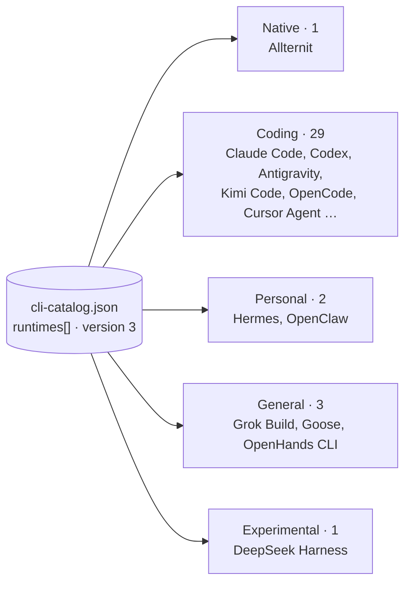

A **runtime** is the agent program a bot runs on: how it works. Allternit's own runtime is one of them. The other 35 are agent CLIs from other companies: Claude Code, Codex, Antigravity, Kimi Code, OpenCode, Hermes, OpenClaw and more. You pick a runtime for a bot, then a [brain](/guides/brains-and-access) it thinks with. See [The agent model](/concepts/agent-model) for how the parts fit.

Every surface reads the same list: Desktop, ai.allternit.com, the PWA, the iPhone and Android apps, and Gizzi Code. It comes from one registry, so a runtime added there appears everywhere in the next release.

<Frame caption="The runtime gallery: all 36 runtimes running the same session (one request, three tool steps, one answer), each in its own look.">
  
</Frame>

## How the catalog is organised



| Category | What it means |
|---|---|
| **Native** | Allternit's own runtime. Runs any brain, with any access, with or without a computer. |
| **Coding** | Coding agents: they read and edit files and run commands in a project folder. Most of the catalog. |
| **Personal** | Personal assistant agents that keep running for you: Hermes and OpenClaw. |
| **General** | General agents that are not only for code: Grok Build, Goose, OpenHands. |
| **Experimental** | Listed so you can see it, not yet driven by Allternit. |

Twelve runtimes sit under **More** in the pickers, so the first list stays short. Type a filter or open **More** to see them.

## The catalog

Columns:

- **Adapter**: how Allternit talks to the runtime. **ACP** (the Agent Client Protocol) and **stream JSON** give live tool steps. **Codex app server** is Codex's own protocol. **Gateway** talks to a running service. **One-shot JSON** and **text** run one prompt and read the result.
- **Brains**: "any", or the only providers the runtime can run. Claude Code runs Anthropic models; Codex runs OpenAI models.
- **Access**: how its brains can be paid for. **plan** is a subscription you already have, **API key** is your own key, **local** is a model on your computer, **credits** are Allternit credits.

The tables below are generated from the registry (`cmd/gizzi-code/src/runtime/providers/discovery/cli-catalog.json`).

### Native

| Runtime | Vendor | Adapter | Brains | Access | Notes |
|---|---|---|---|---|---|
| Allternit (`allternit`) | Allternit | built in | any | plan, API key, local, credits |  |

### Coding

| Runtime | Vendor | Adapter | Brains | Access | Notes |
|---|---|---|---|---|---|
| Claude Code (`claude`) | Anthropic | stream JSON | `anthropic`, `claude` only | plan, API key | alias `claude-cli` |
| Codex (`codex`) | OpenAI | Codex app server | `openai`, `chatgpt` only | plan, API key | alias `codex-cli` |
| Qwen Code (`qwen-cli`) | Alibaba | stream JSON | any | plan, API key |  |
| Kimi Code (`kimi`) | Moonshot AI | ACP | any | plan, API key | alias `kimi-cli` |
| Antigravity (`antigravity`) | Google | ACP | any | plan, API key | alias `agy` |
| Cursor Agent (`cursor-agent`) | Cursor | stream JSON | any | plan, API key |  |
| OpenCode (`opencode`) | Anomaly | stream JSON | any | plan, API key, local | own web app |
| CodeBuddy (`codebuddy`) | Tencent | stream JSON | any | plan, API key |  |
| Qoder CLI (`qodercli`) | Qoder | ACP | any | plan, API key |  |
| Qoder CN (`qoderclicn`) | Qoder | ACP | any | plan, API key | under More |
| Kiro CLI (`kiro-cli`) | Amazon | ACP | any | plan, API key |  |
| Pi (`pi`) | Earendil | one-shot JSON | any | API key, local |  |
| Oh-My-Pi (`omp`) | Oh-My-Pi | one-shot JSON | any | API key, local | under More |
| DevEco Code (`deveco`) | Huawei | stream JSON | any | plan, API key | under More |
| Trae CLI (`traecli`) | ByteDance | ACP | any | plan, API key |  |
| QwenPaw (`qwenpaw`) | Alibaba | ACP | any | plan, API key |  |
| Reasonix (`reasonix`) | Reasonix | ACP | any | plan, API key |  |
| MiniMax Code (`mcode`) | MiniMax | ACP | any | plan, API key |  |
| Gemini CLI (`gemini-cli`) | Google | text | any | API key | API key or Enterprise only; under More |
| GitHub Copilot CLI (`copilot`) | GitHub | text | any | plan, API key |  |
| Aider (`aider`) | Aider | text | any | API key, local | own web app |
| Amp (`amp`) | Sourcegraph | text | any | plan, API key |  |
| Crush (`crush`) | Charm | text | any | API key, local | under More |
| Cline (`cline`) | Cline | text | any | plan, API key | under More |
| Kilo Code CLI (`kilo`) | Kilo Code | text | any | plan, API key | under More |
| Factory Droid (`droid`) | Factory | text | any | API key |  |
| Augment Auggie (`auggie`) | Augment Code | text | any | plan, API key | under More |
| Continue CLI (`continue-cli`) | Continue | text | any | plan, API key | under More |
| Warp Oz (`warp-oz`) | Warp | text | any | plan, API key | under More |

### Personal

| Runtime | Vendor | Adapter | Brains | Access | Notes |
|---|---|---|---|---|---|
| OpenClaw (`openclaw`) | OpenClaw | gateway | any | API key, local | own web app; desktop look |
| Hermes (`hermes`) | Nous Research | ACP | any | API key, local |  |

### General

| Runtime | Vendor | Adapter | Brains | Access | Notes |
|---|---|---|---|---|---|
| Grok Build (`grok`) | xAI | ACP | any | plan, API key |  |
| Goose (`goose`) | Block | text | any | API key, local | desktop look |
| OpenHands CLI (`openhands`) | All Hands AI | text | any | plan, API key, local | under More; own web app; desktop look |

### Experimental

| Runtime | Vendor | Adapter | Brains | Access | Notes |
|---|---|---|---|---|---|
| DeepSeek Harness (`dsh`) | DeepSeek | not supported | any | API key, local | under More |
## What each kind is good at

- **Allternit** when you want any brain, credits, or no computer at all. It is the only runtime that works from the web and phones with no computer linked.
- **Claude Code** and **Codex** when you already pay for a Claude or ChatGPT plan and want that vendor's own agent, with its own tuning. Both are brokered: every tool call reaches Allternit's broker first.
- **Kimi Code**, **Antigravity**, **Hermes**, **Kiro CLI** and the other ACP runtimes when you want live tool steps and approvals from a runtime that can run many brains.
- **OpenCode**, **Aider** and **Pi** when you want to run a local model through a coding agent (local access).
- **Hermes** and **OpenClaw** for a personal assistant that keeps its own state.
- **Goose** and **OpenHands** for general tasks, with a desktop-style look.

The [System layers](/concepts/system-layers#which-runtimes-are-brokered) page lists which runtimes send each tool call to the broker. Pick one of those for a bot that must ask before it writes.

## Google: Antigravity, and Gemini CLI since June 18, 2026

On June 18, 2026, Google stopped serving Google AI Pro, Ultra and free accounts in Gemini CLI. Google plan users now use **Antigravity CLI** (`agy`). So in Allternit:

| | Antigravity (`antigravity`, alias `agy`) | Gemini CLI (`gemini-cli`) |
|---|---|---|
| Google AI Pro, Ultra, free | Yes | No, stopped June 18, 2026 |
| Paid Gemini API key | Yes | Yes |
| Google enterprise coding license | Not stated by Google | Yes |
| Where it sits | Main list, Coding | Under **More**, labelled "API key or Enterprise only" |
| How Allternit drives it | ACP (`agy acp`), with live tool steps and the broker. If the ACP start fails, it falls back to `--print` text mode | One-shot text |

- **Gemini the brain** does not change. Gemini models still come through a Google plan, an API key or Allternit credits.
- **The Gemini app** (gemini.google.com) is a separate product. Its Gems connect as [connected bots](/guides/connected-bots).
- Antigravity signs in only inside its own interactive screen, so run `agy` once on the computer to sign in. See [Connect a coding tool from chat](/guides/connect-from-chat).

## See it in the terminal

```bash
gizzi runtime catalog          # the main runtimes, by category
gizzi runtime catalog --all    # also the ones under More
gizzi runtime catalog --json   # every entry as JSON, with installed status where known
```

See [gizzi runtime](/cli/runtime). In the Gizzi TUI, `/runtime` opens the same list as a picker.

## From code

```bash
curl https://<cloud-api>/api/v1/runtimes
```

Returns `{version, runtimes}`. On your own computer, the runtime also says which CLIs are installed and signed in. See [Runtimes API](/api/runtimes).

## Related

- [Runtime views](/guides/runtime-views)
- [Brains and access](/guides/brains-and-access)
- [Agent card](/guides/agent-card)
- [Add a runtime](/build-on-allternit/add-a-runtime)
