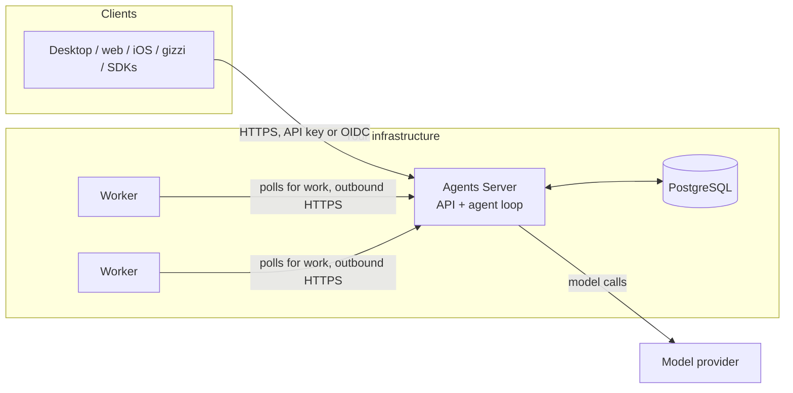

<Note>
**Status: Private beta.** The server (`allternit-agents-server`) is being built against the contract in `cmd/allternit-api/openapi/selfhost-v1.yaml`. These pages describe the intended behaviour from that contract. Commands and flags can change before release.
</Note>

Allternit Self-Hosted Agents is an agent server you run on your own infrastructure. You run the API, the agent loop, the database and the sandbox workers. No Allternit account is needed, and the server makes no calls to `*.allternit.com`.

## What you run

| Part | What it does | Where it runs |
|---|---|---|
| **Agents Server** (`allternit-agents-server`) | The HTTP API, keys and roles, and the agent loop. Model calls and MCP calls happen here. | Your host or cluster, one replica in v1. Listens on `127.0.0.1:8400` by default. |
| **PostgreSQL** | Agents, environments, sessions, the event log, the work queue, tool calls, keys and stored credentials. SQLite is available for development. | Next to the server, or your managed PostgreSQL 16. |
| **Workers** (`gizzi worker`) | Run sandboxed tools (bash, file reads and edits, search) in `/workspace`. They poll the server for work over outbound HTTPS. | Any host that can reach the server. The server never connects to a worker. |
| **Model provider** | Answers model calls. Anthropic, Amazon Bedrock, Google Vertex AI, Microsoft Foundry, or your own gateway. | Wherever your provider runs. |
| **Clients** | Allternit Desktop, ai.allternit.com and the PWA, the iOS app, Gizzi Code, and the SDKs. | Your users' devices. They connect to your server URL with a server API key or your identity provider. |

## Architecture

A turn works like this:

1. A client sends a message to a session (`POST /v1/sessions/{id}/messages`).
2. The agent loop on the server calls the model. A turn that only needs the model finishes here, with no worker.
3. When the model asks for a sandboxed tool, the server queues a tool call for the session's environment.
4. A worker for that environment claims the work, runs the tool in its sandbox and posts the result.
5. The loop continues. The client follows every step on the event stream (`GET /v1/sessions/{id}/events/stream`).

## The one outbound dependency

The server needs to reach your model provider. Everything else it talks to is something you run or name in the settings file: PostgreSQL, MCP servers you allow, your identity provider, your secret store and your telemetry collector. See [Networking](/self-hosted/networking#hosts-the-server-talks-to) for the full list.

Web tools (web search and fetch) are off in v1.

## How it differs from BYOC

[BYOC](/byoc/overview) runs the Allternit data plane on your hardware, but it still depends on `api.allternit.com`: sign-in, pairing and the WebSocket relay go through it.

| | BYOC | Self-Hosted Agents |
|---|---|---|
| Allternit account | Required (sign-in through the Cloud API) | Not used |
| Pairing and relay | Node pairs with the Cloud API and receives calls over a WSS relay | None. Clients call your server directly |
| State | SQLite on the node | PostgreSQL (SQLite for development) |
| Sandboxed tools | On the node | On workers that poll a queue |
| Calls to `*.allternit.com` | Yes | None |

## What v1 does not do

- One deployment serves one tenant. Run a separate deployment per tenant.
- One server replica. After a restart, sessions continue from the event log in PostgreSQL.
- No credential-injecting egress gateway. Workers enforce the environment's network rules.
- No web tools.

## Next

<CardGroup cols={2}>
  <Card title="Quickstart" icon="/icons/play.svg" href="/self-hosted/quickstart">
    Start the compose bundle, mint the first key, run a session.
  </Card>
  <Card title="Configuration" icon="/icons/gear.svg" href="/self-hosted/configuration">
    Every key in the settings file.
  </Card>
  <Card title="Workers" icon="/icons/chip.svg" href="/self-hosted/workers">
    Modes, flags, leases and the session secret.
  </Card>
  <Card title="Client apps" icon="/icons/screen.svg" href="/self-hosted/client-apps">
    Connect Desktop, web, iOS and Gizzi Code to your server.
  </Card>
</CardGroup>
