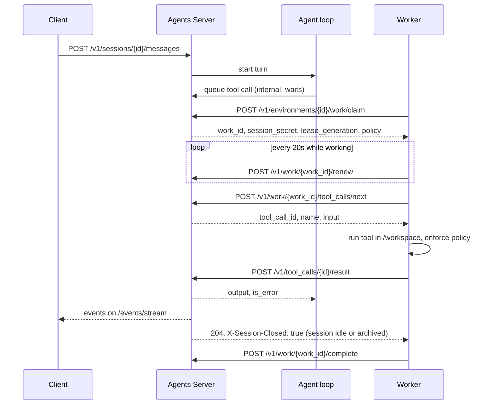

<Note>
**Status: Private beta.** `gizzi worker` is being built on the existing fabric worker. This page follows `docs/SELFHOST_WORKER_PROTOCOL.md` and the work routes in `selfhost-v1.yaml`.
</Note>

A worker runs the agent's sandboxed tools. The agent loop stays on the server: model calls and MCP calls happen there and never reach a worker. When the loop needs a sandboxed tool, the server queues a tool call, and a worker for that environment runs it and posts the result.

Workers only make outbound HTTPS calls to the server. The server never connects to a worker, so workers can sit behind NAT or a firewall with no inbound ports.

## What a worker runs

`gizzi worker` runs these tools with gizzi's own tool code, in `/workspace`:

`bash`, `read`, `write`, `edit`, `multiedit`, `apply_patch`, `notebook`, `grep`, `glob`, `ls`, `symbol-edit`, `background-task`, `scratchpad`.

For tools your own code runs (`custom` tools on an agent), use the worker helper in the SDKs. See [SDKs](/self-hosted/sdks#custom-tool-worker). The `gizzi worker` CLI does not know custom tools and answers them with an error result, so SDK workers run them.

## One worker, one session

A worker serves one session at a time. Run as many workers as you want concurrent sessions. The compose bundle runs 10.

## The sandbox

`bash` runs in a sandbox with the environment's network rules. On macOS the sandbox is `sandbox-exec`. On Linux it is bubblewrap, plus `socat` for the `limited` network mode. A Linux worker without bubblewrap refuses bash calls. It does not run them unsandboxed.

## How a work item ends

A session has at most one open work item. A work item ends only when `POST /v1/work/{work_id}/tool_calls/next` answers **204 with the header `X-Session-Closed: true`**. That happens when the session is archived or has been idle for `sessions.idle_timeout` (default `1h`). Then the worker calls `/complete`.

A plain 204 (no header) is an empty wait, not the end. Poll again. Never complete after an empty wait: the session may send a tool call later.

While a tool call has no worker, the session shows `waiting_for_worker`. After `sessions.no_worker_timeout` (default `10m`) the call fails with `no_worker` and the model sees a tool error.

On a graceful server shutdown, open long-polls end at once.

## Modes

| Mode | Flag | What it does |
|---|---|---|
| Always-on | (default) | Claims work in a loop and runs each item. Does not exit on its own. |
| Drain | `--drain` | Claims one item, runs it, completes it and exits 0. With no work, exits 0 after one empty claim. Good for a cron job or a CI step. |
| On-work | `--on-work ./spawn.sh` | For each item, runs the script once. The script gets `WORK_ID`, `SESSION_ID` and `LEASE_GENERATION` in its environment and starts a sandbox. The worker keeps the lease alive until the script exits. Good for one fresh VM or container per item. |

## Flags

| Flag | What it does |
|---|---|
| `--server URL` | The Agents Server URL. |
| `--environment-key aek_...` | The environment key. It sets which environment the worker serves. |
| `--block-ms N` | How long one claim waits for work before the server answers "nothing" (0 to 30000). |
| `--drain` | Drain mode (above). |
| `--on-work SCRIPT` | On-work mode (above). |
| `--reclaim-older-than-ms N` | Also claim items whose lease ran out at least this long ago. This is how work from a dead worker comes back. |
| `--auto-stop` | Listed in the protocol. Its exact stop rule is still being defined. |

The repo also ships a systemd unit, `gizzi-worker.service`, for always-on workers.

## Leases

- A claim gives a **60 second lease**. Renew it every **20 seconds** (`POST /v1/work/{work_id}/renew`). A heartbeat (`/heartbeat`) between renewals is optional.
- Every claim raises the item's **`lease_generation`**. Every call about the item (`heartbeat`, `renew`, `complete`, `release`) carries the generation from the claim.
- An old generation gets **409 `lease_stale`**. Another worker owns the item now. The worker stops at once, discards its results and posts nothing.
- If a lease runs out, the item becomes ready again, and another worker can take it with `reclaim_older_than_ms`.
- On shutdown, a worker calls `/release`. The item goes back to ready at once.
- A worker finishes with `/complete`, after the session-closed signal above. Completing twice with the current generation is safe.
- Send `X-Worker-Hostname` and `X-Worker-Version` on claim, heartbeat, renew, complete and release. They show in the worker list below.

## Tool calls are at least once

- A worker asks for the next call with `POST /v1/work/{work_id}/tool_calls/next` (long-poll). A plain 204 means poll again; 204 with `X-Session-Closed: true` means the item is finished.
- A call that was handed out but has no result is handed out again after the lease changes hands. So a call can run more than once.
- Each call has a stable `tool_call_id`. A worker runs each id once and remembers it. The server stores one result per id and ignores a second post.
- A result is at most **100 KiB**. A larger one gets **413 `result_too_large`**. Truncate and post again.
- Tools that change things outside the sandbox should be safe to repeat.

## The session secret

The claim returns a `session_secret`. The worker sends it as `X-Session-Secret` on the tool-call routes.

- It works for **one session** only. It does not work on other sessions, on `/v1/agents` or on admin routes.
- It ends when the lease ends. A new claim gets a new secret.
- Only the worker process holds it. It is not written to logs, to the sandbox filesystem or to tool output, and it is not passed into the sandbox.

The environment key (`aek_...`) can claim work for its environment. It cannot read agents or other sessions.

## Network rules

The claim carries the environment's network policy, as it was when the item was claimed. The worker enforces it on every outbound connection from the sandbox. Refusals use the code `host_not_allowed`. A change to the environment reaches a worker on its next claim. See [Networking](/self-hosted/networking).

## See the workers

```bash
curl -s $ALLTERNIT_SERVER_URL/v1/environments/env_.../workers -H "Authorization: Bearer $ALLTERNIT_SERVER_API_KEY"
```

This lists workers seen in the last 10 minutes, newest first. `online` is true for a worker seen in the last 60 seconds. Each environment also reports `worker_count` and `queue_depth`. `gizzi runtime status` shows the same numbers.

## Sequence


